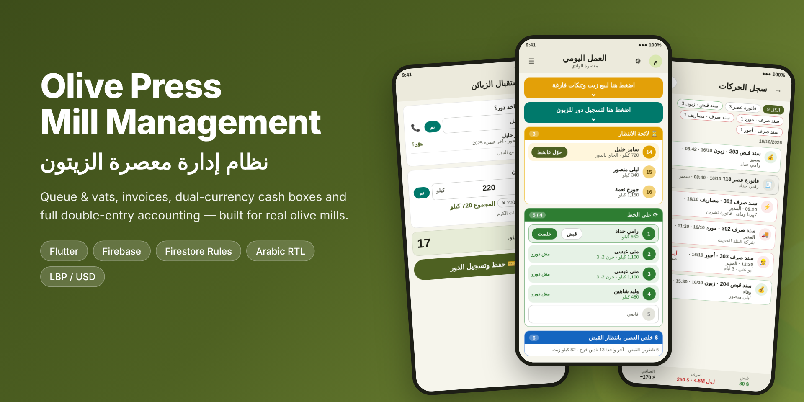
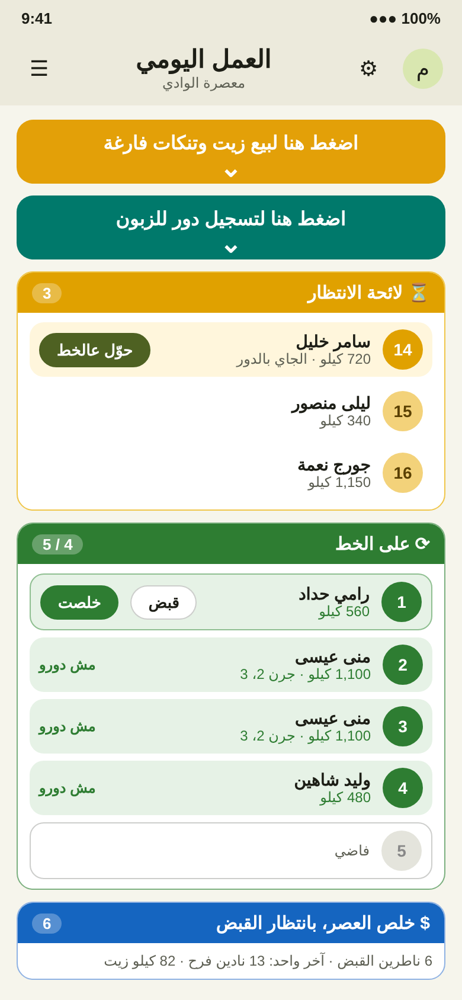
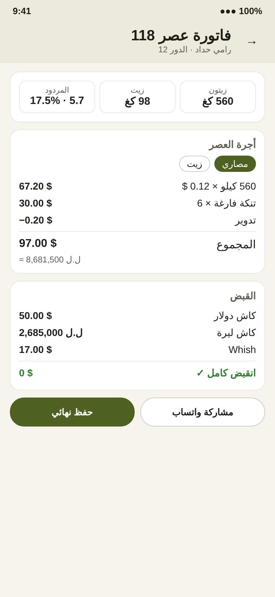
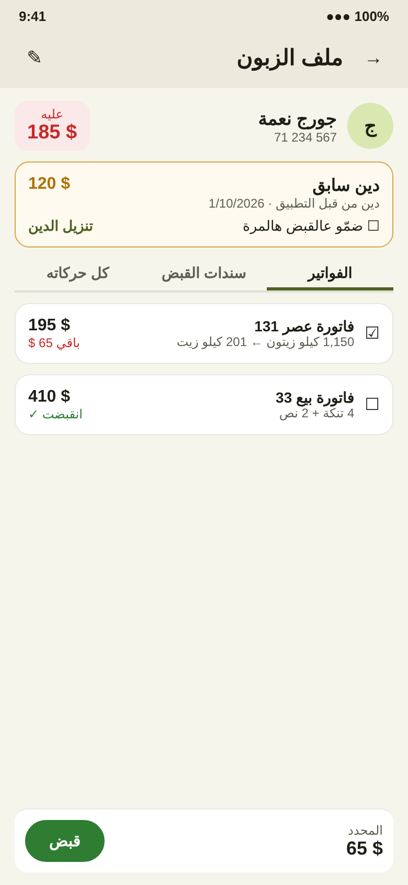
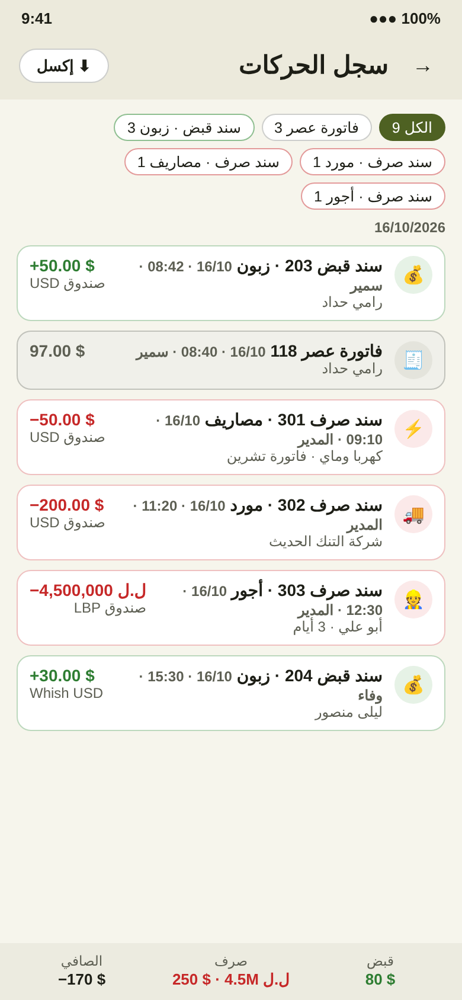
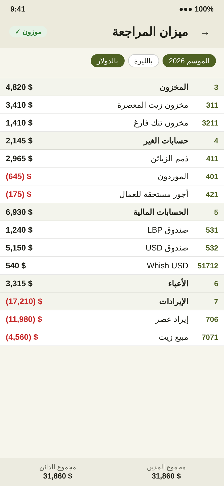

  

<h1 align="center">Olive Press — Olive Mill Management</h1>

<b>نظام إدارة معصرة الزيتون</b>

  
  
  
  

A complete management app for olive oil mills: customer turns and vats, pressing invoices, oil and empty-tin sales, cash boxes in two currencies (LBP / USD), payment and receipt vouchers, inventory, suppliers, staff wages, and a full double-entry accounting system that posts every operation automatically.

It runs in a real olive mill during the 2026 season, used daily by the owner and staff.

> The source code is private (commercial product). Code walkthrough or access is available on request.

---

## Screens

Screen previews with demo data (no real customer information).

| Daily work | Turn registration | Pressing invoice |
|:---:|:---:|:---:|
|  |  |  |
| **Customer file** | **Movements log** | **Trial balance** |
|  |  |  |

---

## Features

### Daily operations
- **Live queue**: waiting list, on the line, and finished pressings waiting for payment.
- **Vat allocation**:
  - The olive quantity is split across vats by capacity, in rotation.
  - Vats that are still busy are skipped.
  - Overflow kilos wait for the next free vat.
  - Vats are finished in the order they were filled.
- **Fast turn registration**:
  - Type a name and see similar existing customers, or create a new customer file instantly.
  - The phone number is optional.
  - Multiple scale weighings are summed automatically.
- **Separate groves**: one turn can be split into separate pressings, or several customers batched into one pressing.
- **Oil and empty-tin sales**: for registered or walk-in customers.

### Invoicing & collection
- **Pressing fee** in money (per kg) or in oil (percentage or fixed).
- **Multi-currency payments**: cash LBP, cash USD, and transfer methods (Whish, OMT…), with live exchange rate and rounding.
- **Receipts**: partial payments, one receipt across several invoices, and edit or void with a full audit trail.
- **Old debts**: debts from before the app are kept apart, collected only when selected, and can be written off to bad debts.

### Cash & vouchers
- **Cash boxes per currency**, plus daily cash count with shortage and overage posting.
- **Unified vouchers**:
  - *Receipt voucher* and *Payment voucher*, each tagged with its party (customer, supplier, expenses, wages, owner, misc).
  - Each type has its own number sequence.
- **Movements log**: every document in one place, with combined filters, search, per-user filter, totals and Excel (CSV) export.

### Accounting (double-entry)
- **Chart of accounts**: Lebanese-style, with custom sub-accounts.
- **Automatic journal entries** for every document: invoices, receipts, sales, purchases, vouchers, stock and wages.
- **Corrections**: an edit or void creates a reversal plus a new entry. Entries are never deleted.
- **Reports**: trial balance, account statements and opening balances. Balances move to capital at go-live.

### Inventory & purchases
- **Items**: tins, jars and spare parts, with automatic units and weighted average cost.
- **Suppliers and purchases**: purchase invoices (olives, oil, tins, parts), supplier payments and supplier statements.
- **Stock**: adjustments (damage, count), per-item movement card, and an item profit report.

### Staff & customers
- **Roles and permissions**: owner, manager and staff, each screen behind a permission.
- **Wages**: work days with a daily rate, paid through payment vouchers, with the balance owed per worker.
- **Customer app**: live turn status, invoices and payments (configurable by the mill), and posts from the mill.

---

## Tech stack & architecture

- **Flutter** (Material 3)
  - Arabic RTL and English, using ARB localization.
  - Tablet- and web-friendly layouts.
- **Firebase Authentication**: role-based users (platform admin, mill owner, manager, staff, customer).
- **Cloud Firestore**: multi-tenant (`mills/{millId}/…`).
  - All money operations run in **transactions**, which keep counters, totals and journal entries consistent.
  - Offline persistence, plus local caches for customers and cash boxes.
- **Firestore Security Rules** enforce the business rules on the server:
  - Role and permission checks per collection.
  - Validated status transitions (waiting → on line → finished → closed).
  - Sequential document numbers tied to counters in the same transaction.
  - **Balanced journal entries in both currencies**.
  - Append-only records: corrections by reversal only.
- **Firebase Hosting** for the web build.

---

## نبذة بالعربي

تطبيق كامل لإدارة معصرة زيتون، **شغّال فعلياً بمعصرة خلال موسم 2026**:

- **العمل اليومي**:
  - الدور المباشر: الانتظار، على الخط، وخلص العصر.
  - توزيع الأجران تلقائياً حسب السعة، والخلاص بترتيب التعبئة.
  - تسجيل دور سريع بالاسم، وتجميع الوزنات.
- **الفواتير والقبض**:
  - أجرة العصر مصاري أو زيت.
  - قبض بالليرة والدولار وWhish/OMT.
  - ديون سابقة وتنزيل ديون.
- **الصناديق والسندات**:
  - سند قبض وسند صرف مع الجهة، ولكل نوع ترقيمه.
  - جرد صندوق يومي.
  - سجل حركات موحّد.
- **محاسبة مزدوجة كاملة**:
  - دليل حسابات، وقيود تلقائية لكل عملية.
  - ميزان مراجعة، وكشف حساب، وأرصدة افتتاحية.
- **المستودع والمشتريات**: أصناف، موردين، فواتير شراء، تصحيح مخزون، وأرباح الأصناف.
- **الموظفين**: صلاحيات لكل شاشة، وأيام شغل وأجرة يومية.
- **تطبيق الزبون**: يشوف دوره مباشرة وفواتيره.

**التقنيات:** Flutter · Firebase (Auth, Firestore, Hosting) · Firestore Security Rules · عربي RTL وإنكليزي.

---

## Contact

**Hussein El Youssef** — Flutter developer, computer & communications engineer

- Email: [alyoussif.hussein@gmail.com](mailto:alyoussif.hussein@gmail.com)
- GitHub: [@Husseinelyoussef](https://github.com/Husseinelyoussef)
